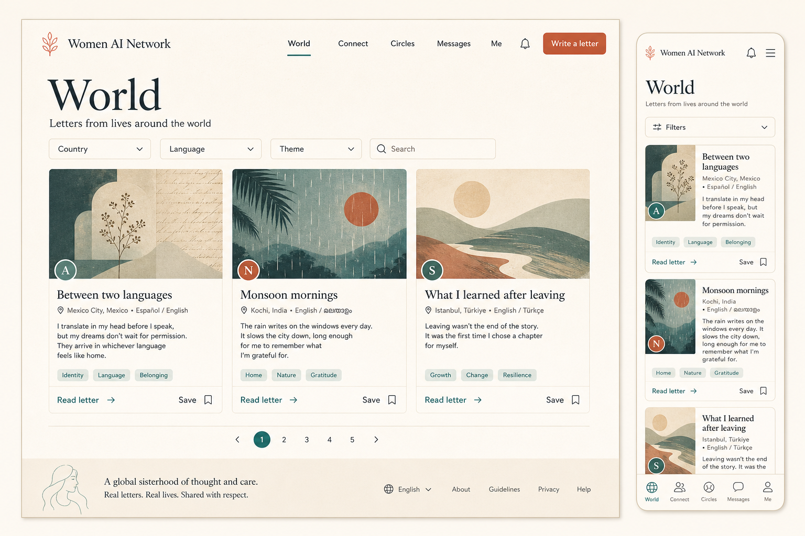

# Women AI Network

A privacy-first, policy-driven community platform for cross-border discovery, consent-based connections, circles, letters, messaging, and multilingual delivery.

> Portfolio snapshot. This repository demonstrates the product architecture and engineering implementation; it is not a claim that the service is currently operating in production.



_The image above is an approved design concept used to validate the desktop and mobile experience._

## What I owned

I independently defined the product constraints, designed the system architecture, planned the implementation, reviewed the code, designed the verification strategy, and owned the final delivery.

This project is evidence of end-to-end technical ownership: translating a sensitive product idea into explicit privacy invariants, data contracts, services, migrations, policy gates, test suites, and deployment operations.

## System highlights

- Next.js web application with responsive desktop and mobile flows
- Node.js API, asynchronous worker, BullMQ, Valkey, and PostgreSQL
- Contract-first TypeScript packages shared across web, API, and worker
- Policy-based authorization and database-level privacy boundaries
- Explicit consent and interaction gates for introductions and connections
- Private letters, circles, messaging, notification outbox, and translation jobs
- Verification and media-review provider boundaries with mockable adapters
- Idempotent background work, signed events, redacted observability, and recovery tooling
- Docker-based local infrastructure, staging workflows, migrations, health checks, and encrypted backups

## Architecture

```text
Next.js web
    |
    v
Node API ---- policy / authorization packages
    |                         |
    +---- PostgreSQL <--------+
    |
    +---- Valkey / BullMQ ----> Worker ----> provider adapters
                                  |
                                  +---- notifications / media / translation
```

The codebase treats privacy as a system property rather than a UI preference. Sensitive operations are checked at the API and persistence boundaries, background payloads are minimized, and logs are designed to redact credentials and private content.

## Repository map

| Path | Purpose |
| --- | --- |
| `apps/web` | Responsive Next.js product interface |
| `apps/api` | HTTP API and domain modules |
| `apps/worker` | Queue consumers and asynchronous delivery |
| `packages/contracts` | Shared request, event, and domain contracts |
| `packages/db` | PostgreSQL schema and migrations |
| `packages/authz` | Authorization and policy foundations |
| `tests` | Contract, integration, privacy, and real-journey tests |
| `deploy` | Staging and production-process configuration |
| `docs/adr` | Architectural decisions and invariants |

## Local verification

Requirements: Node.js `>=22.23.2 <23`, pnpm `11.18.0`, and Docker Desktop.

```bash
pnpm install --frozen-lockfile
docker compose up -d --wait
pnpm format:check
pnpm lint
pnpm typecheck
pnpm test
pnpm test:contracts
pnpm test:integration
pnpm build
pnpm test:e2e
```

See [`docs/runbooks/local-development.md`](docs/runbooks/local-development.md) for the complete setup and [`docs/runbooks/production-launch.md`](docs/runbooks/production-launch.md) for the release controls.

### Verified snapshot — 2026-08-24

- Formatting, lint, type checking, and the production build passed.
- 722 unit, contract, service, and UI-state tests passed.
- 264 Docker-backed integration tests passed; 13 provider-gated tests were skipped by their explicit local prerequisites.
- 22 Playwright desktop/mobile browser tests passed.
- Gitleaks 8.30.0 reported no leaks in the curated snapshot.
- The production dependency audit passed the high-severity gate: 0 high, 0 critical, and 2 current moderate transitive advisories.

## Scope and disclosure

- Demo fixtures and design concepts are included; no real member data is included.
- External identity, moderation, translation, storage, and delivery providers require separately supplied credentials.
- A production launch still requires real infrastructure, domain, provider, security, legal, and operational review.

## Source terms

The project code is shared for portfolio evaluation and technical review. It is not offered under an open-source license. Third-party packages retain their own licenses; see [`THIRD_PARTY.md`](THIRD_PARTY.md) and [`LICENSE`](LICENSE).
